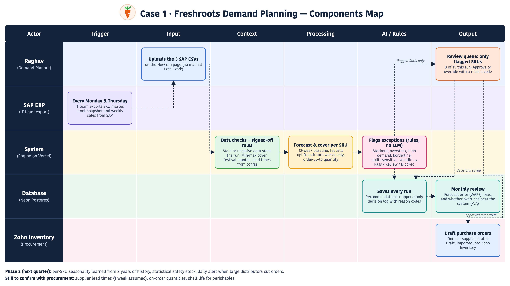

# Freshroots replenishment engine

A rules-based engine that only surfaces exceptions, with Raghav approving every order.

```
SAP export → data checks → forecast + stock cover → rules (fixed order) → order-up-to qty
          → review queue → Raghav approves/overrides with a reason → Zoho draft POs → decision log → monthly review
```

Python 3.8+, standard library only. Nothing to install for the local tools.

## Hosted version (Vercel + Neon)

The same engine runs as a website: `public/index.html` is the screen, and `api/index.py` is one Vercel Python function that stores runs and decisions in Neon Postgres (`schema.sql`).

- **New run.** Upload the three SAP CSVs. The engine runs and the run is saved.
- **Review queue.** Raghav saves decisions. They go into the `decisions` table, which is append-only.
- **Create Zoho drafts.** Downloads the draft PO CSV.
- **Runs.** Every past run. `/api/decisions.csv` exports the full log for `review.py`.

Deploy: create a Neon database, run `schema.sql`, set `DATABASE_URL` in the Vercel project, and push to `main`. The site has no login: anyone with the link can save decisions.

## Distributor queries and metric alerts

Two more tabs in the hosted app (`ops.py`, tables in `schema.sql`, register seeded by `seed_metrics.sql`):

- **Distributor queries:** CS reps log every WhatsApp query (7 categories). The tool sets a 2-working-hour first-reply deadline (Mon–Sat 9:00–19:00 IST) and keeps a history of reply, reassign and resolve. It tracks the 6-week automate-or-not gate: automate only if routine queries are 60% or more. Export: `/api/queries.csv`.
- **Metric alerts:** a 12-metric owner register (owner, trigger, action, deadline, escalation contact). Owners acknowledge alerts with the action taken; an alert still open after its deadline escalates to Deepa. Escalation is applied whenever alerts are read, so no scheduler is needed. A raw material PO above 5 lakh goes through a gate alert that shows the last 48 hours of alerts before sign-off. Each engine run raises a stockout alert for A-class SKUs at risk.

The operating plan behind both is a separate document shared with Deepa.

## Local tools: twice a week (Mon/Thu)

```bash
python3 run.py          # reads data/, writes outputs/<run_id>/
python3 approve.py      # opens the review queue at http://localhost:8765
```

1. Drop the SAP export (`sku_master.csv`, `current_inventory.csv`, `weekly_sales.csv`) into `data/`, or pass `--data <folder>`.
2. `run.py` stops with exit code 2 if a data check fails (stale snapshot, negative stock, duplicate rows, stale sales, unknown SKU). It recommends nothing in that case.
3. In the approval screen, Raghav saves each flagged SKU. If he changes the quantity or picks "No order", he must give a reason code.
4. **Create Zoho drafts** writes `outputs/<run_id>/zoho_po_drafts.csv` (one draft PO per vendor, status Draft) for the Zoho Inventory import. Nothing is sent to Zoho automatically.

## Monthly

```bash
python3 review.py --sales <latest weekly_sales.csv>
```

This reports forecast error (WAPE) and bias for each past run. It also reports Forecast Value Added, meaning whether each override landed closer to the hindsight-ideal quantity than the system's number did, grouped by reason code.

## Files

| File | What it is |
|---|---|
| `config.json` | Every threshold and assumption. Raghav signs this off |
| `engine.py` | Data checks, forecast, rules, segmentation, KPI baseline |
| `run.py` | CLI that writes the run outputs |
| `approve.py` + `approve.html` | Approval screen, decision log, Zoho export |
| `review.py` | Monthly accuracy and override review |
| `outputs/<run>/recommendations.csv` | Every SKU with numbers, flags and reasons |
| `outputs/<run>/review_queue.csv` | Only the SKUs that need Raghav |
| `outputs/<run>/parallel_run_compare.csv` | Rules as Raghav wrote them vs the engine, side by side, for weeks 4–8 |
| `outputs/<run>/kpi_baseline.json` | Starting KPIs |
| `outputs/decisions_log.csv` | Append-only log of every decision, across runs |

## Rule order (fixed)

1. **Data checks.** A run-level failure stops everything. A SKU-level failure (missing weeks, under 12 weeks of history, no stock row, zero recent sales) makes the SKU **BLOCKED**: it goes to Raghav with no system quantity.
2. **Baseline.** The baseline is the 12-week average and the trend is the 4-week average, both on raw history. The festival uplift is never applied to this comparison.
3. **Forward forecast.** The baseline is multiplied by 1.25 only for future weeks that fall in Oct, Nov or Mar. Cover is the number of weeks the current stock lasts against that forecast, so a cover window that runs into December is uplifted for its Oct/Nov weeks only.
4. **Stockout risk** (cover < min). Order up to the target cover after lead time, rounded to 10. It is flagged EXPEDITE if stock runs out before the lead time ends. *(Fixes gap 1.)*
5. **Overstock** (cover > max). Pause, unless cover is within 10% of the max. In that case it doesn't pause and tops up to target instead. *(Fixes gap 2.)*
6. **High demand** (4-week average > 20% above the 12-week average). This never auto-orders. It shows an "if the trend is real" quantity. If the SKU is also overstocked it is flagged CONFLICT.
7. **Assumption-sensitive.** If the flag changes when the festival uplift is removed, the SKU goes to review. *(Fixes gap 3.)*
8. **Volatile** (Z segment) always goes to review.
9. **Routing.** No action and no flags → **PASS**. Routine orders for segments listed in `auto_approve_segments` → **AUTO** (the list is empty during the parallel run). Everything else → **REVIEW**.

## Settle with Raghav and procurement before go-live

- **Supplier lead times** (`lead_time_weeks`). These are not in the export, so 1 week is assumed for now. Order quantities and EXPEDITE depend on them.
- **Shelf life** for perishables (`shelf_life_weeks`). Once filled in, it caps the order-up-to target and flags stock that would expire.
- **Target cover** (8 weeks standard, 3.5 weeks perishable). These sit between his min and max limits. They are a proposal, not his rule.
- **On-order quantities.** These are not in the export yet. Until they are, a second run before a PO arrives will suggest ordering again.
- **Vendor mapping.** Draft POs are grouped by `Distributor_ID` from the SKU master. IT should confirm which Zoho vendor each one maps to, and map the CSV columns in Zoho's import wizard.
- **ABC by revenue.** The export has no prices, so ABC uses unit volume for now.

## Phase 2 (next quarter)

- Learn a per-SKU seasonal index from the 3 years of history, replacing the flat 25%. The 12-week average already contains October weeks, so the flat uplift partly double-counts.
- Move the reorder trigger to a statistical reorder point: lead-time demand + z·σ·√LT. Safety stock is already shown as a reference column.
- Add a daily alert for drops in distributor-level orders.

## Components map



Hindi version: [docs/components_map_hi.png](docs/components_map_hi.png). Both are served on the live site at `/components_map.png` and `/components_map_hi.png`. Regenerate with `python3 tools/make_map.py docs/components_map.svg en` (or `hi`).
